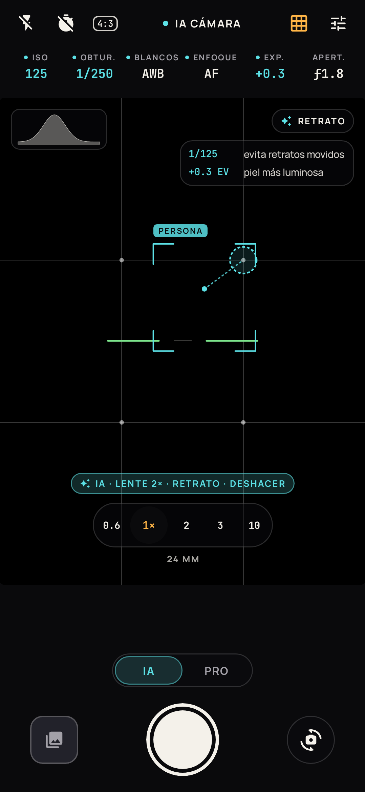
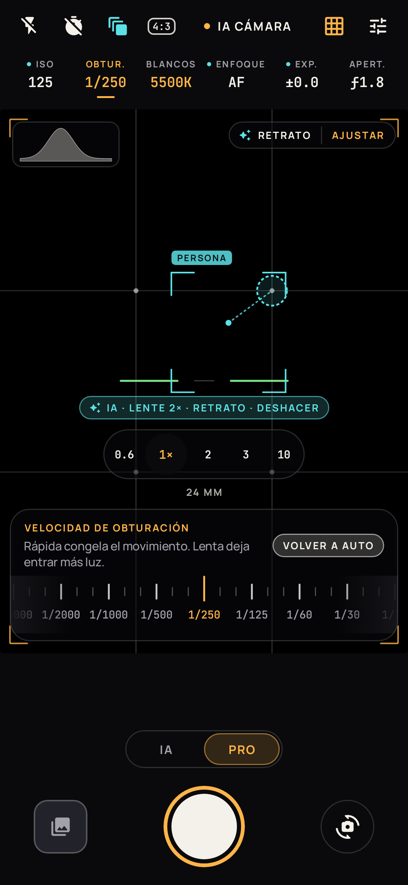

# IA Cámara

Una app de cámara profesional para el **Samsung Galaxy S22+**. Te da control manual completo y te guía en cada foto. Más adelante, la IA reconocerá la escena y ajustará todo como lo haría un fotógrafo.

  

## Instalar en el teléfono

1. Desde el teléfono, abre la pestaña **Releases** del repositorio y entra en **"IA Cámara — última versión"**.
2. Descarga **IA-Camara.apk**.
3. Ábrelo. Si Android lo pide, permite *"Instalar apps desconocidas"* para tu navegador o el gestor de archivos.

Cada cambio que se sube al repositorio vuelve a compilar el APK automáticamente.

## Qué hace

| Zona | Función |
|---|---|
| **Barra superior** | Flash · temporizador (3 s / 10 s) · formato 4:3 o 16:9 · guías · ajustes |
| **Tira de instrumentos** | ISO, obturación, blancos, enfoque, exposición y apertura **en vivo**. Punto cian = lo decide la cámara. Ámbar = lo fijaste tú. Toca cualquiera para ajustarla. |
| **Visor** | Guías (tercios, áurea, centro), nivel de horizonte que se pone verde, histograma, aviso de altas luces |
| **Gestos** | Tocar = enfocar y medir. Mantener = bloqueo AE/AF. Pellizcar = zoom. Botones de volumen = disparar. |
| **Lentes** | 0.6× · 1× · 3× son los tres lentes físicos del S22+. 2× (recorte del sensor de 50 MP) y 10× (tele + recorte) son accesos de zoom digital, como en la cámara de Samsung. Muestra la focal equivalente en mm. |
| **Modo PRO** | Dial tipo regla con vibración en cada paso y una explicación corta de qué hace cada ajuste. Si fijas solo el ISO o solo la velocidad, la app calcula el otro valor con su propio fotómetro (prioridad ISO o prioridad obturación). |

| **IA de escena** (fase 2) | Reconoce retrato, mascota, animal, macro, atardecer, playa, paisaje, ciudad, comida y noche. Combina tres modelos de Google ML Kit (en el teléfono y sin internet) con datos físicos: luz, color y distancia de enfoque. |
| **Sujeto y enfoque** | Recuadro cian sobre el rostro o el sujeto principal. El enfoque y la medición de luz lo siguen solos. |
| **Entrenador de composición** | Línea guía hacia el punto fuerte de los tercios (con los ojos como referencia en retratos), o la línea donde poner el horizonte. Se pone verde y vibra al quedar bien compuesto. |
| **Receta profesional** | Toca **AJUSTAR** y la app aplica lo que haría un fotógrafo para esa escena: lente, velocidad, exposición y blancos. Toca el nombre de la escena para ver los consejos. |

| **Composición con IA** (v0.7) | La cuadrícula en modo **IA** cambia sola según la escena (tercios, áurea en macro, centro en comida desde arriba). **Detecta el horizonte real** (altura e inclinación, aunque lo tape un árbol) y te dice si apuntar más arriba/abajo o girar el teléfono. Deja **espacio hacia donde mira** la persona o **hacia donde corre** el animal. Indicaciones claras: "Mueve el teléfono a la derecha →". |
| **Cerebro fotógrafo** (fase 3) | En modo **IA** ajusta todo solo y de forma continua. Elige la velocidad según el movimiento real del sujeto (IA) y de tu mano (giroscopio), aplicando la regla de pulso según la focal. Aplica la exposición de cada escena y protege las altas luces. Si el teléfono está apoyado (trípode), usa exposición larga con ISO bajo. Cambia de lente cuando la escena lo pide, con opción de deshacer. Cada decisión se explica en pantalla y los valores que decide la IA se ven en **cian**. |

| **Medición inteligente** (IA v2) | Mide la luz **sobre la cara o el sujeto** y lo expone bien aunque esté a contraluz. Expone la nieve "a la derecha" para que salga blanca sin quemarse. Deja quemar lámparas y el sol (puntos de luz) y solo protege zonas grandes como el cielo. Con contraste extremo recomienda **HDR**. |
| **Precisión de la IA** (v0.6) | **Fusión temporal** de escenas (acumula la evidencia de los últimos segundos: no parpadea y cambia en ~0.3 s cuando de verdad cambias de tema). **Puntos de la cara**: mide la luz en la piel y coloca los **ojos** en el punto fuerte. **Seguimiento** del mismo sujeto por identificador. **Teléfono en horizontal**: la IA gira la imagen para reconocer caras igual. **Flujo óptico** (Lucas-Kanade) 8 veces por segundo: movimiento real del sujeto y de la imagen con error < 4 %. |
| **HDR natural** | Combina tomas normales con una 2–3 pasos más oscura, en luz lineal y con transiciones suaves (sin halos). Mide la relación de luz real entre tomas y comprime solo las altas luces. |
| **Tomas múltiples** (fase 4) | **Noche:** combina 6–8 fotos alineadas; el ruido baja ~√N sin el aspecto "pintado" de los filtros, descarta lo que se mueve entre tomas y aclara suavemente las sombras. **Macro+:** 5 fotos a distintas distancias de enfoque que se combinan quedándose con lo más nítido de cada una. En modo IA se eligen solas según la luz y la escena. También se pueden elegir con el botón de tipo de toma en la barra superior (Auto, 1 toma, Noche, Macro+). |
| **Modo retrato** (fase 7) | La IA **recorta al sujeto** (persona, mascota u objeto), ajusta el borde a la foto (pelo, orejas) y **desenfoca el fondo como un lente luminoso**: más desenfoque cuanto más lejos, el suelo delante de los pies más nítido, las luces se vuelven **círculos de bokeh** y sin halos alrededor del sujeto. En modo IA se activa solo con una persona cerca; también se elige con el botón de tipo de toma (**Retrato**). |
| **Visor de fotos** (fase 7) | Al tocar la miniatura se abre la galería de la app: deslizar entre fotos, doble toque para ampliar, cuadrícula, etiqueta de lo que hizo la IA (Retrato, Noche, HDR, Macro+, Mejor momento), compartir, editar y borrar. En los retratos, un control **f/1.2 – f/16** cambia el desenfoque o lo quita del todo (se vuelve a la foto original). |
| **Noche v2** (fase 8) | Tono **local**: aclara las zonas oscuras según la luz de cada zona (no con una curva para toda la foto), contiene las luces fuertes y conserva la textura, sin halos alrededor de farolas o ventanas. Con zoom digital, además, enfoca más. |
| **Súper resolución** (fase 8) | Con zoom digital (2×, 10× o pellizcando) toma 6 fotos: el pulso de la mano las desplaza fracciones de píxel; se alinean, se combinan y se enfoca más que una sola toma (+1.7 dB de detalle medido). Automático en modo IA. |
| **Exposición larga** (fase 8) | Botón de tipo de toma → **Larga**: 10 tomas alineadas y promediadas en luz lineal. El agua se vuelve seda, la gente que pasa desaparece y los faros dejan **estelas continuas**. Toca el disparador para terminar antes. |
| **Astrofotografía** (fase 8) | Con el teléfono apoyado de noche (o con **Astro**): ~30 s de tomas de varios segundos con enfoque al infinito. El cielo se alinea con las **estrellas** (giro de la Tierra), el paisaje se combina fijo, se eliminan los píxeles calientes y se oscurece el fondo del cielo. Toca el disparador para terminar antes. |
| **Mejorar con IA** (fase 9) | En el visor, botón **Mejorar**: **enderezar** (mide la inclinación con las líneas rectas de la foto), **perspectiva** (edificios que "se caen hacia atrás" por el punto de fuga), retoque por **zonas** (cielo más profundo, piel bien expuesta sin suavizar, vegetación con color), brillo y calidez. Vista previa al instante; mantén pulsada la foto para ver la original. Siempre se edita desde la original y se puede **restaurar**. Opcional: retoque por zonas automático en cada foto. |
| **Calificación** (fase 9) | Cada foto recibe una nota de 0 a 100 (nitidez, exposición, ruido, horizonte, ojos abiertos y caras cortadas) con un consejo concreto para cada punto que resta. |
| **Tu estilo** (fase 9) | La IA aprende de tus correcciones: exposición por tipo de escena (cuando compensas en PRO o aclaras en «Mejorar»), calidez, desenfoque de retrato y retoque favoritos. Necesita varias muestras, tiene tope (±0.7 EV), se ve en Ajustes › Tu estilo y se puede olvidar. Nunca sale del teléfono. |
| **RAW (DNG)** | Guarda el archivo en bruto del sensor junto al JPG, si el lente lo permite (se activa en Ajustes). |

Las fotos se guardan en **Imágenes › IA Camara**.

## Diseño

Es un diseño propio, inspirado en principios de apps profesionales:
- la sobriedad de Leica LUX;
- las lecturas técnicas de Blackmagic Camera;
- los diales táctiles de Halide;
- la jerarquía de controles de Moment.

Paleta negro tinta con paneles de vidrio. El ámbar marca la acción y los valores manuales, y el cian todo lo automático o de IA. Tipografía **Manrope** para la interfaz y **JetBrains Mono** para los números, para que no "bailen" al cambiar.

## Hoja de ruta

1. ✅ Control manual total, lentes, guías y diseño
2. ✅ IA en el teléfono (ML Kit): reconocer escena y sujeto, entrenador de composición
3. ✅ "Cerebro fotógrafo": decisiones automáticas de velocidad, exposición, blancos y lente
4. ✅ RAW, apilado multi‑toma (noche), macro con *focus stacking*
5. ✅ Base de fotografía computacional: alineación v2 (por zonas, giro y subpíxel), mezcla robusta y memoria de fotogramas
6. ✅ El momento perfecto: modo Acción (sin retardo + instantes previos), mejor toma (nítida, ojos abiertos, sonrisa), corrección de parpadeos en grupo y disparo automático por sonrisa, mirada o mano levantada
7. ✅ Modo retrato (recorte con IA, borde refinado, profundidad aproximada y bokeh óptico) y visor de fotos con desenfoque ajustable
8. ✅ Súper resolución, modo noche v2 (tono local), exposición larga simulada y astrofotografía
9. ✅ Retoque por zonas, enderezado y perspectiva automáticos, calificación de la foto y aprender tu estilo

## Desarrollo

- Kotlin + Jetpack Compose + CameraX/Camera2. minSdk 29, targetSdk 35.
- `./gradlew assembleRelease` compila el APK.
- `./gradlew testDebugUnitTest` regenera las capturas de la interfaz en `app/build/screenshots/` (Robolectric).
- `tools/descargar_imagenes.sh` descarga ~18 fotos reales de proyectos públicos de visión por computadora (retratos, animales, paisajes, calles) a `app/build/fotos_prueba/`; con ellas se ejecuta además la batería `RealPhotoSuiteTest` (horizonte, modo noche, HDR y macro). No se suben al repositorio.
