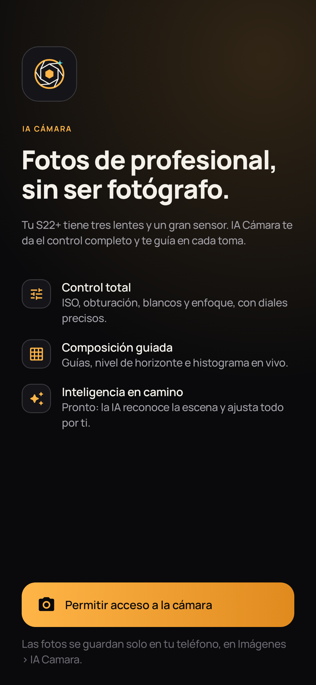

# IA Cámara

Una app de cámara profesional para el **Samsung Galaxy S22+**. Te da control manual completo y te guía en cada foto. Más adelante, la IA reconocerá la escena y ajustará todo como lo haría un fotógrafo.

  

## Instalar en el teléfono

1. Desde el teléfono, abre la pestaña **Releases** del repositorio y entra en **"IA Cámara — última versión"**.
2. Descarga **IA-Camara.apk**.
3. Ábrelo. Si Android lo pide, permite *"Instalar apps desconocidas"* para tu navegador o el gestor de archivos.

Cada cambio que se sube al repositorio vuelve a compilar el APK automáticamente.

## Qué hace (fase 1)

| Zona | Función |
|---|---|
| **Barra superior** | Flash · temporizador (3 s / 10 s) · formato 4:3 o 16:9 · guías · ajustes |
| **Tira de instrumentos** | ISO, obturación, blancos, enfoque, exposición y apertura **en vivo**. Punto cian = lo decide la cámara. Ámbar = lo fijaste tú. Toca cualquiera para ajustarla. |
| **Visor** | Guías (tercios, áurea, centro), nivel de horizonte que se pone verde, histograma, aviso de altas luces |
| **Gestos** | Tocar = enfocar y medir. Mantener = bloqueo AE/AF. Pellizcar = zoom. Botones de volumen = disparar. |
| **Lentes** | 0.6× · 1× · 3× (las cámaras físicas reales del S22+), con su distancia focal equivalente en mm |
| **Modo PRO** | Dial tipo regla con vibración en cada paso y una explicación corta de qué hace cada ajuste. Si fijas solo el ISO o solo la velocidad, la app calcula el otro valor con su propio fotómetro (prioridad ISO o prioridad obturación). |

Las fotos se guardan en **Imágenes › IA Camara**.

## Diseño

Es un diseño propio, inspirado en principios de apps profesionales:
- la sobriedad de Leica LUX;
- las lecturas técnicas de Blackmagic Camera;
- los diales táctiles de Halide;
- la jerarquía de controles de Moment.

Paleta negro tinta con paneles de vidrio. El ámbar marca la acción y los valores manuales, y el cian todo lo automático o de IA. Tipografía **Manrope** para la interfaz y **JetBrains Mono** para los números, para que no "bailen" al cambiar.

## Hoja de ruta

1. ✅ Control manual total, lentes, guías y diseño
2. ⏳ IA en el teléfono (ML Kit / MediaPipe): reconocer escena y sujeto
3. ⏳ "Cerebro fotógrafo": ajustes expertos automáticos según la escena
4. ⏳ RAW, apilado multi‑foto, macro con *focus stacking* y modo noche o trípode

## Desarrollo

- Kotlin + Jetpack Compose + CameraX/Camera2. minSdk 29, targetSdk 35.
- `./gradlew assembleRelease` compila el APK.
- `./gradlew testDebugUnitTest` regenera las capturas de la interfaz en `app/build/screenshots/` (Robolectric).
